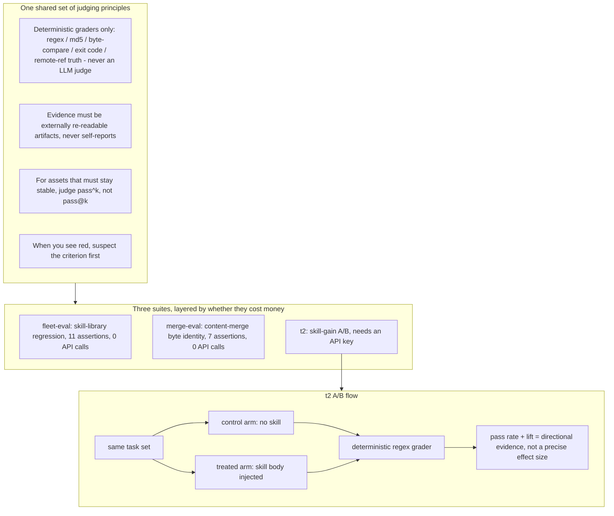

# agent-evals

English | [中文](README.zh-CN.md)


[](https://github.com/kumu314/agent-evals/actions/workflows/ci.yml)
[](LICENSE)
[](package.json)
[](package.json)
[](CHANGELOG.md)
[](docs/t2-results.md)

**Live leaderboard:** <https://kumu314.github.io/agent-evals/>

> **TL;DR** — Injecting a well-written skill lifts a model's pass rate on a locked, deterministic 8-task A/B harness (`temperature=0`, AND-gate grading). Across **11 models** the lift spans **+4 ~ +75 percentage points** — 10 of them clear +38; the lone floor is glm-4-flash. No LLM judge, no vibes: every number here is a re-runnable assertion.

**Who this is for:** teams shipping agent skills or content pipelines that need a regression gate which fails loudly and reproducibly — two of the three suites run at zero API cost. **Who it is not for:** anyone looking for an LLM-as-judge scoring rubric; this repo deliberately avoids one.

Turn "how reliable are AI agents at real work" into machine-checkable assertions, run them after every change, and get a red flag the moment something slips.

Three sub-suites, layered by whether they cost money:

| suite | what it tests | cost | what you need |
|---|---|---|---|
| [`fleet-eval/`](fleet-eval/) | Full skill-library regression: frontmatter validity, duplicate names, leftover junk, multi-endpoint fan-out consistency (11 assertions) | 0 API calls | a skill library on disk |
| [`merge-eval/`](merge-eval/) | Bulk content merge: entries you did not touch must stay byte-for-byte identical (7 assertions) | 0 API calls | a repo under test |
| [`t2/`](t2/) | Skill-gain A/B: same set of tasks, with vs. without the skill injected, compare pass rates | needs an API key | any OpenAI-compatible endpoint |

## Table of contents

- [How it fits together](#how-it-fits-together)
- [Why it is split this way](#why-it-is-split-this-way)
- [What t2 does and does not test](#what-t2-does-and-does-not-test)
- [Full t2 evidence trail](docs/t2-results.md)
- [Quick start](#quick-start)
- [What a run looks like](#what-a-run-looks-like)
- [Directory layout](#directory-layout)
- [One note of honesty](#one-note-of-honesty)
- [Who made this, who it is for](#who-made-this-who-it-is-for)
- [License](#license)

## How it fits together



## Why it is split this way

All three suites share one set of judging principles — the reason this repo exists:

1. **If it can be decided deterministically, do not bring in an LLM as judge.** Every grader across the three suites is a deterministic assertion — regex, md5, byte comparison, exit code, remote-ref ground truth. Not one uses a model to score: it is both expensive and non-reproducible.
2. **Evidence must come from externally re-readable artifacts.** The criteria only trust remote API reads, file sha256, and actual on-disk state — never self-reports like "I finished the run" or "the command did not error".
3. **For assets that must be stable, judge `pass^k`, not `pass@k`.** Correctness of a skill library or content library is a red line: it must pass every one of N runs, not get lucky once.
4. **The criteria themselves can be wrong — when you see red, suspect the criterion first.** Every red in merge-eval's first round turned out to be its own bug. This lesson is written into both sub-suites' READMEs, because it was the most expensive thing learned here.

These three are not original; sources are in [fleet-eval/research/](fleet-eval/research/) (Anthropic's "Demystifying evals for AI agents", NVIDIA's agent-evaluation practice).

## What t2 does and does not test

t2 is a **model-tier selection tool**, not a "are skills universally effective" tool. The question it answers is: "inject this skill into a given model tier — does it flip that tier from FAIL to PASS on a task?" That answer **depends heavily on the model's capability ceiling**.

**Injection is not activation.** The treated arm puts the skill body directly in context. Real harnesses load only a skill's metadata and let the model decide whether to activate it. Every number here is therefore an upper bound on what a skill can buy, not the activation rate you will see in production.

**Scope of the tested skills.** All seven skills under test in t2 are verification-discipline / failure-forensics skills — each encodes one concrete, checkable procedure. Two other genres live outside that locked ruler: domain knowledge gets a small genre pilot, and a negative-arm poison checks the grader from the opposite direction (both under the 'Out-of-ruler arms' section below). Creative work and style are not measured here at all, so the lift table is evidence for this genre, not a claim that skills help in general.

### How to read every number below

Every row shares one methodology, stated once here instead of repeated under each model:

- **One locked ruler** — 8 tasks x 3 trials x 2 arms = 24 calls per arm, `temperature=0`, deterministic regex grading. Scoring is an **AND-gate**: a trial passes only if it hits *all* of that task's criteria.
- **`lift` = treated - control**, in percentage points. It is **directional evidence, not a precise effect size** — at n=24 single-run variance dominates.
- **Thinking config is a real column, not noise.** Some reasoning models blow past the harness's 60 s guard at default thinking, so they are run at a reduced setting (`reasoning_effort=low` / `thinking:disabled`); their floor is a property of that setting, not native-max capability. The per-model reasons for each reduced / disabled setting are recorded in [docs/t2-results.md](docs/t2-results.md).

### Headline results (locked v2+v3 ruler)

| provider | model | control (bare floor) | treated | lift | thinking config |
|---|---|---|---|---|---|
| DeepSeek | deepseek-chat | 29% (7/24) | 88% (21/24) | **+58 pp** | native |
| DeepSeek | deepseek-reasoner (R1) | 13% (3/24) | 79% (19/24) | **+67 pp** | native |
| DeepSeek | deepseek-flash | 36% (8/22) | 91% (21/23) | **+55 pp** | native |
| zhipu | glm-4-plus | 8% (2/24) | 67% (16/24) | **+58 pp** | native |
| zhipu | glm-4-flash | 13% (3/24) | 17% (4/24) | **+4 pp** | native |
| zhipu | glm-5.3 | 13% (3/24) | 88% (21/24) | **+75 pp** | `reasoning_effort=low` |
| MIMO | mimo-v2.6-flash | 17% (4/24) | 79% (19/24) | **+63 pp** | `thinking:disabled` |
| MIMO | mimo-v2.6-pro | 29% (7/24) | 96% (23/24) | **+67 pp** | `thinking:disabled` |
| Alibaba | qwen3.8-flash | 29% (7/24) | 75% (18/24) | **+46 pp** | `reasoning_effort=low` |
| Alibaba | qwen3.8-max | 25% (6/24) | 63% (15/24) | **+38 pp** | `reasoning_effort=low` |
| StepFun | step-5-preview | 21% (5/24) | 83% (20/24) | **+63 pp** | native |

All rows report 0 tool-calls; transient upstream disconnects are excluded from the pass-rate denominator (exact valid-call counts are in the results doc). **Full per-model readings, the v2/v3 calibration record, and per-task breakdowns are in [docs/t2-results.md](docs/t2-results.md).**

### What the fleet tells you

- **The skill's gain is real and usually large.** Across the eleven tested models, lift runs **+4 ~ +75 pp**, with ten of eleven at +38 or higher. `glm-4-flash` (+4) is the lone weak row — the injection barely moved it, which is exactly why the next bullets say to test the specific model, not the tier.
- **Lift tracks the bare-answer floor, not headline tier.** The widest gaps sit on the *lowest* floors (R1 13% -> +67, glm-5.3 13% -> +75); the narrowest on the *highest* (qwen3.8-max 25% -> +38). `step-5-preview` is a flagship yet floors low (21%) and so lifts wide (+63) — a model's floor is how well it happens to land on these specific criteria, not a clean proxy of its strength.
- **Tier cannot be equated across brands.** Same skill, same criteria: `glm-4-flash` lifts +4 while `mimo-v2.6-flash` lifts +63 — test the specific model, not the tier name.
- **Within a brand, tier gaps are steeper than across brands.** In zhipu alone, `glm-4-flash` (+4) -> `glm-4-plus` (+58): one swap moves the effect from 0 to +58.
- **The ceiling is local, not global.** Where general reasoning already solves a task (`bad-advice-runtime`) both arms saturate and that point contributes 0 lift; the AND-gate keeps at least one skill-unique criterion unmet on the domain tasks, so the aggregate never collapses.

### Out-of-ruler arms

Two arms live outside the locked ruler above and are deliberately kept out of the headline table, so its denominator never moves:

- **Negative (poison) arm.** A deliberately-wrong skill is injected into the treated arm, and the grader must catch the model being led astray - treated should land *below* control. It runs as a fail-closed self-check inside `npm test`: on canned answers the grader reads it at the opposite extreme of the ruler, proving the regex fires in both directions. Whether a real model can actually be led astray is still an open question, not a proven result (see the results doc); a sharper poison is the next step there.
- **Domain-knowledge genre pilot.** To probe whether the harness transfers beyond the verification-discipline genre, one domain-knowledge task (`cache-nocache-vs-nostore`, on the `http-cache-semantics` skill) runs as a genre pilot. It is flagged out of the default run and fires only when named explicitly, so it joins neither the locked ruler nor the table above; it currently has a self-check only, no measured lift yet.

### Usage guidance

- Want to verify "does my skill actually help"? -> first make sure the test tier is >= your target deployment tier, or you are measuring the model's ceiling, not the skill's quality.
- Picking "which model tier should my agent use"? -> the same skill's lift across tiers is exactly the selection signal.
- Do not read "lift = 0" as "the skill is useless" — it only says "this tier cannot parse it".

## Quick start

Requires Node ≥ 20.11 (uses `import.meta.dirname` and the built-in `fetch`). The runtime floor is declared in `package.json` under `engines`.

```bash
# Run every zero-API / zero-network self-check in one shot (equivalent to CI, cross-platform; env is set in-process, no shell prefix needed)
npm test          # = node run-checks.mjs, prints an rc ledger step by step, non-zero exit on any failure

# 0) See it work in one command: run against the sample skill library shipped in the repo, red first then green (zero config, zero API)
node demo/run.mjs

# 1) t2 scoring-pipeline self-check: zero API calls, proves "the criteria really can tell good answers from bad"
node t2/smoke-ab.mjs --dry

# 2) fleet-eval: point it at your skill-library root first, then run
FLEET_SHARED=/path/to/sharedskills node fleet-eval/fleet-eval.mjs --trials 2

# 3) merge-eval: point it at the repo under test + the pre-merge sha
MERGE_REPO=/path/to/repo MERGE_REPO_SLUG=owner/repo \
MERGE_BASE_REF=<pre-merge sha> MERGE_TOUCHED_IDS='["id1","id2"]' \
node merge-eval/merge-eval.mjs --trials 2
```

Each suite's environment variables, criteria list, and the pitfalls hit along the way are in the README inside each subdirectory.

## What a run looks like

The one zero-config, free command (CI runs it too):

```bash
node t2/smoke-ab.mjs --dry
```

It walks the scoring pipeline with pre-set answers to prove "the criteria really can separate good answers from bad". Full output:

```text
provider = DRY (zero calls)
tasks    = bad-advice-runtime(runtime-resolution-and-abi), merge-verify-ritual(silent-failure-triage), guard-never-fires(silent-failure-triage), tautology-detector(criterion-self-evidence-check), changed-but-not-visible(stale-output-layers), stale-line-citation(line-anchor-drift), hash-mismatch-invisible(text-encoding-forensics), push-hung-recheck(git-push-fake-timeout)   trials/arm = 3   arms = control+treated
------------------------------------------------------------------------
[control] bad-advice-runtime t1  FAIL      (no hit)  61c
[control] bad-advice-runtime t2  FAIL      (no hit)  61c
[control] bad-advice-runtime t3  FAIL      (no hit)  61c
[treated] bad-advice-runtime t1  PASS      rejects-the-note,pins-the-technique  185c
[treated] bad-advice-runtime t2  PASS      rejects-the-note,pins-the-technique  185c
[treated] bad-advice-runtime t3  PASS      rejects-the-note,pins-the-technique  185c
...
control valid 24/24 (passed 0)   tool calls 0   errors 0
treated valid 24/24 (passed 24)  tool calls 0   errors 0
control pass = 0% [0,14]   treated pass = 100% [86,100]   lift = 100 percentage points
=> the two arms are distinguishable (the pipeline has discriminative power)
```

(Shown abbreviated; `--dry` uses fixed pre-set answers, so control scores 0 and treated scores 100 — it checks the ruler, not the model.)

## Directory layout

```
agent-evals/
├── demo/              one-command demo: bundled sample skill library, red first then green (zero config)
├── docs/              eval-primitives.md — the five eval primitives distilled from all three suites
├── fleet-eval/        skill-library regression (11 assertions, zero API cost)
│   ├── fleet-eval.mjs
│   ├── drill-a1a2.mjs     negative-verification script: proves new assertions really go red
│   ├── fleet-eval.allow.example.json  junk.absent exemption allowlist template (the real one is not committed)
│   └── research/          methodology sources
├── lib/               parsers.mjs — the three parsers shared by all suites (single implementation)
├── merge-eval/        bulk content-merge regression (7 assertions)
│   ├── merge-eval.mjs
│   ├── drill-merge-eval.mjs  negative-verification drill: TMP git fixture, zero network
│   └── README.md
├── selftest.mjs       unit tests for lib/parsers.mjs (node:test, zero dependencies)
└── t2/                skill-gain A/B (needs an API key)
    ├── smoke-ab.mjs
    └── skills/        seven ruler skills plus a negative-arm poison and a domain-knowledge pilot (self-authored, MIT)
```

## One note of honesty

`fleet-eval` and `merge-eval` grew out of two of the author's own real projects: a shared skill library (240+ skills, 4 fan-out endpoints) and a bulk-ingestion pipeline for a content site. Their criteria and pitfall logs come from real incidents, so the docs keep many "measured on this machine" concrete readings — those are not design goals, they are field evidence.

## Who made this, who it is for

Built by me ([@kumu314](https://github.com/kumu314)) for my own use, open-sourced along the way.

Suited to anyone holding assets that are "annoying when they break, but you don't want to pay another round of model-call fees on every regression" — skill libraries, content libraries, multi-endpoint distributed configs. Not for people treating evals as a leaderboard to farm.

## License

MIT, see [LICENSE](LICENSE).
