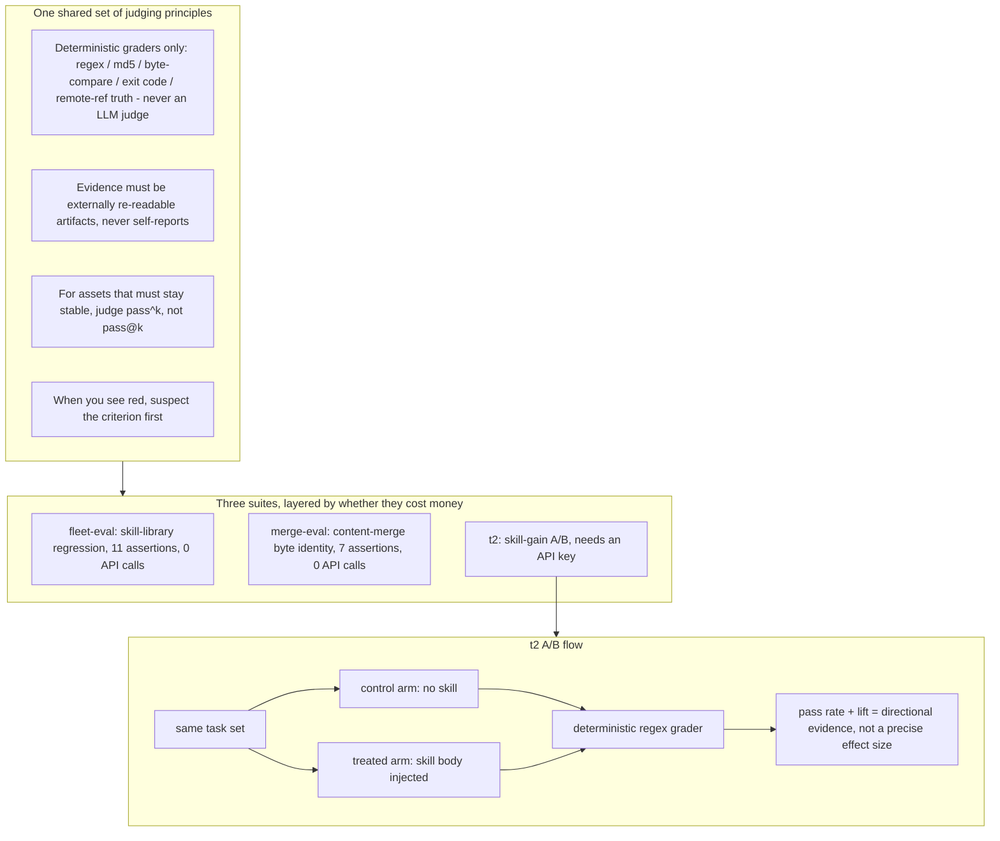

# agent-evals

English | [中文](README.zh-CN.md)

[](https://github.com/kumu314/agent-evals/actions/workflows/ci.yml)
[](LICENSE)

Turn "how reliable are AI agents at real work" into machine-checkable assertions, run them after every change, and get a red flag the moment something slips.

Three sub-suites, layered by whether they cost money:

| suite | what it tests | cost | what you need |
|---|---|---|---|
| [`fleet-eval/`](fleet-eval/) | Full skill-library regression: frontmatter validity, duplicate names, leftover junk, multi-endpoint fan-out consistency (11 assertions) | 0 API calls | a skill library on disk |
| [`merge-eval/`](merge-eval/) | Bulk content merge: entries you did not touch must stay byte-for-byte identical (7 assertions) | 0 API calls | a repo under test |
| [`t2/`](t2/) | Skill-gain A/B: same set of tasks, with vs. without the skill injected, compare pass rates | needs an API key | any OpenAI-compatible endpoint |

## Table of contents

- [How it fits together](#how-it-fits-together)
- [Why it is split this way](#why-it-is-split-this-way)
- [What t2 does and does not test](#what-t2-does-and-does-not-test)
- [Quick start](#quick-start)
- [What a run looks like](#what-a-run-looks-like)
- [Directory layout](#directory-layout)
- [One note of honesty](#one-note-of-honesty)
- [Who made this, who it is for](#who-made-this-who-it-is-for)
- [License](#license)

## How it fits together



## Why it is split this way

All three suites share one set of judging principles — the reason this repo exists:

1. **If it can be decided deterministically, do not bring in an LLM as judge.** Every grader across the three suites is a deterministic assertion — regex, md5, byte comparison, exit code, remote-ref ground truth. Not one uses a model to score: it is both expensive and non-reproducible.
2. **Evidence must come from externally re-readable artifacts.** The criteria only trust remote API reads, file sha256, and actual on-disk state — never self-reports like "I finished the run" or "the command did not error".
3. **For assets that must be stable, judge `pass^k`, not `pass@k`.** Correctness of a skill library or content library is a red line: it must pass every one of N runs, not get lucky once.
4. **The criteria themselves can be wrong — when you see red, suspect the criterion first.** Every red in merge-eval's first round turned out to be its own bug. This lesson is written into both sub-suites' READMEs, because it was the most expensive thing learned here.

These three are not original; sources are in [fleet-eval/research/](fleet-eval/research/) (Anthropic's "Demystifying evals for AI agents", NVIDIA's agent-evaluation practice).

## What t2 does and does not test

t2 is a **model-tier selection tool**, not a "are skills universally effective" tool. The question it answers is: "injecting this skill into a given model tier — does it flip that tier from FAIL to PASS on this task?" That answer **depends heavily on the model's capability ceiling**.

**Measured evidence**: run in two batches. The first batch of 4 tasks proved the pipeline can separate the two arms; the expanded batch doubled the sample (4 → 8 tasks) to re-check the effect size.

First batch (4 tasks × 3 trials × 2 arms = 12 per arm):

| provider | model | control pass | treated pass | lift |
|---|---|---|---|---|
| DeepSeek | deepseek-chat | 25% (3/12) | 100% (12/12) | **+75 pp** |
| zhipu | glm-4-flash | 25% (3/12) | 25% (3/12) | **0 pp** |
| MIMO | mimo-v2.6-flash | 25% (3/12) | 100% (11/11 valid calls, 1 upstream disconnect listed separately) | **+75 pp** |

Expanded batch (8 tasks × 3 trials × 2 arms = 24 per arm, doubling the sample to re-check):

| provider | model | control pass | treated pass | lift |
|---|---|---|---|---|
| DeepSeek | deepseek-chat | 13% (3/24) | 79% (19/24) | **+67 pp** |
| MIMO | mimo-v2.6-flash | 21% (5/24) | 75% (18/24) | **+54 pp** |
| zhipu | glm-4-flash | 13% (3/24) | 13% (3/24) | **0 pp** |
| zhipu | glm-4-plus | 13% (3/24) | 71% (17/24) | **+58 pp** |

Reading both batches together: **the direction holds** — the two arms still separate sharply; but **the precise effect size converges** (+75 → +54~+67 pp). The newer tasks' criteria sit closer to fine-grained points that are "unique to the skill body and unreachable by a bare model"; real-model wording does not necessarily hit every point (e.g. MIMO FAILs all three `merge-verify-ritual` treated trials; DeepSeek's `push-hung-recheck` criterion is tight), and a few control answers hit the ceiling (`push-hung-recheck` passes on two models even with a bare answer). +75 pp is an optimistic reading under a small sample plus curated tasks; +54~+67 pp is the more conservative estimate after expanding the sample — which is exactly the point that must be said: **lift is directional evidence, not a precise effect size.**

Criterion calibration (2026-10-17): two false-negative fixes, each a **monotonic relaxation** (can only turn more valid answers green, never a wrong one) verified against a deliberately-wrong guardrail string plus a `--dry` re-check:
- **v2** — `push-hung-recheck`'s "trust the remote read" check credited only `ls-remote`, mis-judging a control arm that correctly verified remote truth via `git fetch` + reading the `origin/<branch>` SHA as FAIL.
- **v3** — `merge-verify-ritual`'s "exit code 0 carries no information" check credited only answers phrased with the `退出码0/成功时` prefix, missing conceptually-correct phrasings like "no output carries no signal" stated without that prefix.

After both fixes the ruler is locked (v2 + v3). A single full 8-task re-run of **all four providers on this one ruler** (temperature=0, 24 calls/arm, 0 tool-calls / 0 errors throughout):

| provider | model | control pass | treated pass | lift |
|---|---|---|---|---|
| DeepSeek | deepseek-chat | 29% (7/24) | 88% (21/24) | **+58 pp** |
| zhipu | glm-4-plus | 8% (2/24) | 67% (16/24) | **+58 pp** |
| MIMO | mimo-v2.6-flash | 17% (4/24) | 79% (19/24) | **+63 pp** |
| zhipu | glm-4-flash | 13% (3/24) | 17% (4/24) | **+4 pp** |

This 4/4 aggregate supersedes the earlier v2 partial readings (DeepSeek 33/83/+50, glm-4-plus 17/58/+42), which used the v2-only ruler and left MIMO / glm-4-flash pending. Three strong models land in **+58~+63 pp**; the small `glm-4-flash` barely moves (+4) — a real capability floor, not a ruler artifact: its treated answers lengthen and most criterion words appear, but it misses one required check per task and scoring demands **all** checks hit. Loosening the ruler to rescue flash's number would be "changing the number to treat the symptom" and is deliberately not done. **lift remains directional evidence, not a precise effect size.**

**Stronger-model probe (2026-10-18)**: the obvious follow-up is “does a more capable model make the skill redundant — i.e. compress lift toward 0?” Ran `deepseek-reasoner` (R1) on the same locked v2+v3 ruler, `temperature=0`, 24 calls/arm, 0 tool-calls / 0 errors. Result: **control 13% (3/24), treated 79% (19/24), lift +67 pp** — the widest gap in this fleet, not the narrowest. The ceiling effect is real but *local*, not global: R1’s bare answer saturates exactly one task (`bad-advice-runtime`, where “different node builds aren’t interchangeable” is reachable by general reasoning, so both arms PASS and lift there is 0), and one task stays out of reach for both arms (`push-hung-recheck`, where even the treated answer hits only 2 of 3 criteria). On the other six, R1 answers fluently and hits *most* criteria but systematically misses at least one skill-specific point — and because scoring is an AND-gate (all criteria must hit), lift stays wide. Reading: **a stronger base model raises the bare-answer floor on the few tasks a general reasoner can solve unaided, but does not absorb the skill’s marginal value on the domain-specific ones**; +67 pp on R1 is directional evidence on n=24, same caveat as every other row.

**Frontier-model batch (2026-10-19)**: pushed one generation further — `deepseek-flash`, `glm-5.3`, `mimo-v2.6-pro` — on the same locked v2+v3 ruler, same 8 tasks × 3 trials × 2 arms (24 calls/arm). Model IDs were read live from each vendor's `/models` endpoint, not guessed. Channel and any thinking-config deviation are stated honestly:

| provider | model | control pass | treated pass | lift |
|---|---|---|---|---|
| DeepSeek | deepseek-flash (native) | 36% (8/22) | 91% (21/23) | **+55 pp** |
| zhipu | glm-5.3 (`reasoning_effort=low`) | 13% (3/24) | 88% (21/24) | **+75 pp** |
| MIMO | mimo-v2.6-pro (`thinking:disabled`) | 29% (7/24) | 96% (23/24) | **+67 pp** |
| Alibaba | qwen3.8-flash (`reasoning_effort=low`) | 29% (7/24) | 75% (18/24) | **+46 pp** |
| Alibaba | qwen3.8-max (`reasoning_effort=low`) | 25% (6/24) | 63% (15/24) | **+38 pp** |
| StepFun | step-5-preview (native) | 21% (5/24) | 83% (20/24) | **+63 pp** |

deepseek-flash: 0 tool-calls, 3 transient `terminated` connection drops (excluded from the rate, as in every row). glm-5.3 and mimo-v2.6-pro: 0 tool-calls / 0 errors. **Two honest deviations:** glm-5.3 *always thinks* and rejects `thinking:disabled`; its default (max) thinking took ~148 s/call — past the harness's 60 s guard — so it ran at `reasoning_effort=low` (~14 s/call), and its 13% bare floor is a property of that setting, not native-max capability. mimo-v2.6-pro native thinking likewise timed out the 60 s guard, so it ran with `T2_DISABLE_THINKING=1` (same handling as `mimo-v2.6-flash`). To support this the harness gained an opt-in `T2_REASONING_EFFORT` passthrough (default unset → no change to any earlier row). Read with R1: lift on current frontier tiers stays wide (**+55 ~ +75 pp**) and does **not** compress toward zero as models get stronger; the ceiling effect remains *local* (glm-5.3 even PASSes the hardest `push-hung-recheck` bare), because AND-gate scoring keeps at least one skill-specific criterion unmet on the domain tasks. **Still directional evidence on n=24, same caveat as every row.**

**Qwen3.8-flash addendum (2026-10-19)**: also ran Alibaba `qwen3.8-flash` (same locked ruler, ID live-verified from its `/models`). Native thinking is heavy — ~122 s/call, past the 60 s guard — so it ran at `reasoning_effort=low` (~20 s/call), the same opt-in passthrough glm-5.3 used (ruler unchanged). Result: **control 29% (7/24), treated 75% (18/24), lift +46 pp** — 0 tool-calls / 0 errors. This was the **narrowest** lift in the fleet at the time (qwen3.8-max below is narrower), and it refines rather than overturns the finding: a capable current-gen flash tier lifts the *bare-answer floor* (29%, among the highest here — `bad-advice-runtime` saturates both arms) yet treated still stays clearly ahead, and the AND-gate keeps `hash-mismatch-invisible` unmet even for treated (only 2 of 3 criteria hit). Directional evidence on n=24, same caveat as every row.

**Qwen3.8-max addendum (2026-10-19)**: also ran the flagship `qwen3.8-max` on the same locked ruler and the same `reasoning_effort=low` passthrough (native thinking is heavier still; low holds each call at ~20 s, inside the 60 s guard). Result: **control 25% (6/24), treated 63% (15/24), lift +38 pp** — 0 tool-calls / 0 errors. This is now the **narrowest lift in the fleet**, below qwen3.8-flash’s +46, and it sharpens the trend rather than overturning it: across the Qwen line the narrowing is monotonic (flash +46, max +38 — under the deepseek/glm/mimo batch’s +55~+75) yet still positive. The strongest same-brand tier lifts the bare-answer floor further (control saturates *two* tasks bare — `bad-advice-runtime` and `guard-never-fires` both 3/3), leaving the skill less AND-gate head-room; and a counter-intuitive tell — max’s treated is *lower* than flash’s (63% vs 75%): a more capable model is not uniformly better at landing the specific criterion phrasings (`merge-verify-ritual` treated falls to 1/3). The AND-gate still bites where a skill-unique criterion is missing (`hash-mismatch-invisible` 0/3 treated, `push-hung-recheck` treated 2/3). Directional evidence on n=24, same caveat as every row.

**StepFun step-5-preview addendum (2026-10-19)**: added a sixth frontier model — StepFun (`step-5-preview`, via `https://api.stepfun.com/v1`), run natively (no reasoning knob needed: it answers in ~37 s/call and reports `reasoning_tokens=0`). Result: **control 21% (5/24), treated 83% (20/24), lift +63 pp** — 0 tool-calls / 0 errors (a few calls crossed the 60 s window and were auto-retried, all 48 ultimately valid). Its bare-answer floor (21%) is the second-lowest in the frontier batch, behind only glm-5.3's 13% — which is exactly why its lift lands mid-wide rather than narrow, reinforcing the pattern the batch already shows: lift tracks the bare-answer floor, and that floor is not a clean proxy of headline tier (glm-5.3 already floored at 13% with the widest +75 lift, and qwen3.8-max's +38 stays the narrowest here). Per-task it delivers three clean AND-gate skill wins outright (`merge-verify-ritual`, `tautology-detector`, `stale-line-citation` all 0/3 to 3/3), saturates the two easy tasks in both arms, and still struggles with `push-hung-recheck` (treated 1/3) — the same hardest task that caps every model. Directional evidence on n=24, same caveat as every row.

Cross-brand comparison (first batch) still holds: same skill set, same criteria, same tasks — change only the model, and lift ranges from +75 (DeepSeek, MIMO) to 0 (zhipu). Mechanism (glm-4-flash): treated output is visibly longer (the skill is clearly being read and quoted), but the specific criterion words do not hit — an abstract rule cannot land on a scorable concrete phrasing. Yet mimo-v2.6-flash, also a flash tier, hits every one: **"tier" cannot be equated across brands** — selection must be tested down to the specific model, not just the tier name.

Same-brand, cross-tier (expanded batch, re-run 2026-10-17): within zhipu itself, going from `glm-4-flash` (lift 0; treated ties control at 13%, each of 7 tasks hitting only 1–2 criteria and never all) up to `glm-4-plus` (lift **+58 pp**, treated 17/24) — one skill unchanged, criteria unchanged, only the tier swapped — raises the effect size from 0 to +58. **The tier gap within one brand is more violent than the same-tier gap across brands**, the most direct evidence for "test down to the specific model/tier, don't just trust the tier name". glm-4-plus's +58 pp lands in the same band as DeepSeek (+67) / MIMO (+54), showing the plus tier is already at parity with other brands' strong tiers. (Readings via this machine's zhipu OpenAI-compatible channel `https://open.bigmodel.cn/api/paas/v4`, `temperature=0`, 24 calls per arm; the earlier "no key on this machine" was a misjudgment — the variable is `ZHIPUAI_API_KEY`.)

**Usage guidance**:
- Want to verify "does my skill actually help"? → First make sure the test tier is ≥ your target deployment tier, otherwise you are measuring the model's ceiling, not the skill's quality.
- Want to pick "which model tier should my agent use"? → The lift difference of the same skill across tiers is exactly the selection signal.
- Do not read "lift = 0" as "the skill is useless" — it only says "this tier cannot parse it".

Full two-arm readings for the first batch are in the [v0.3.0 Release Notes](https://github.com/kumu314/agent-evals/releases/tag/v0.3.0); per-trial two-arm readings and setup for the expanded 8 tasks are in CHANGELOG `[Unreleased]` → Verification.

## Quick start

Requires Node ≥ 20.11 (uses `import.meta.dirname` and the built-in `fetch`). The runtime floor is declared in `package.json` under `engines`.

```bash
# Run every zero-API / zero-network self-check in one shot (equivalent to CI, cross-platform; env is set in-process, no shell prefix needed)
npm test          # = node run-checks.mjs, prints an rc ledger step by step, non-zero exit on any failure

# 0) See it work in one command: run against the sample skill library shipped in the repo, red first then green (zero config, zero API)
node demo/run.mjs

# 1) t2 scoring-pipeline self-check: zero API calls, proves "the criteria really can tell good answers from bad"
node t2/smoke-ab.mjs --dry

# 2) fleet-eval: point it at your skill-library root first, then run
FLEET_SHARED=/path/to/sharedskills node fleet-eval/fleet-eval.mjs --trials 2

# 3) merge-eval: point it at the repo under test + the pre-merge sha
MERGE_REPO=/path/to/repo MERGE_REPO_SLUG=owner/repo \
MERGE_BASE_REF=<pre-merge sha> MERGE_TOUCHED_IDS='["id1","id2"]' \
node merge-eval/merge-eval.mjs --trials 2
```

Each suite's environment variables, criteria list, and the pitfalls hit along the way are in the README inside each subdirectory.

## What a run looks like

The one zero-config, free command (CI runs it too):

```bash
node t2/smoke-ab.mjs --dry
```

It walks the scoring pipeline with pre-set answers to prove "the criteria really can separate good answers from bad". Full output:

```text
provider = DRY (zero calls)
tasks    = bad-advice-runtime(runtime-resolution-and-abi), merge-verify-ritual(silent-failure-triage), guard-never-fires(silent-failure-triage), tautology-detector(criterion-self-evidence-check), changed-but-not-visible(stale-output-layers), stale-line-citation(line-anchor-drift), hash-mismatch-invisible(text-encoding-forensics), push-hung-recheck(git-push-fake-timeout)   trials/arm = 3   arms = control+treated
------------------------------------------------------------------------
[control] bad-advice-runtime t1  FAIL      (no hit)  61c
[control] bad-advice-runtime t2  FAIL      (no hit)  61c
[control] bad-advice-runtime t3  FAIL      (no hit)  61c
[treated] bad-advice-runtime t1  PASS      rejects-the-note,pins-the-technique  185c
[treated] bad-advice-runtime t2  PASS      rejects-the-note,pins-the-technique  185c
[treated] bad-advice-runtime t3  PASS      rejects-the-note,pins-the-technique  185c
...
control valid 24/24 (passed 0)   tool calls 0   errors 0
treated valid 24/24 (passed 24)  tool calls 0   errors 0
control pass = 0%    treated pass = 100%    lift = 100 percentage points
=> the two arms are distinguishable (the pipeline has discriminative power)
```

(Shown abbreviated; `--dry` uses fixed pre-set answers, so control scores 0 and treated scores 100 — it checks the ruler, not the model.)

## Directory layout

```
agent-evals/
├── demo/              one-command demo: bundled sample skill library, red first then green (zero config)
├── docs/              eval-primitives.md — the five eval primitives distilled from all three suites
├── fleet-eval/        skill-library regression (11 assertions, zero API cost)
│   ├── fleet-eval.mjs
│   ├── drill-a1a2.mjs     negative-verification script: proves new assertions really go red
│   ├── fleet-eval.allow.example.json  junk.absent exemption allowlist template (the real one is not committed)
│   └── research/          methodology sources
├── lib/               parsers.mjs — the three parsers shared by all suites (single implementation)
├── merge-eval/        bulk content-merge regression (7 assertions)
│   ├── merge-eval.mjs
│   ├── drill-merge-eval.mjs  negative-verification drill: TMP git fixture, zero network
│   └── README.md
├── selftest.mjs       unit tests for lib/parsers.mjs (node:test, zero dependencies)
└── t2/                skill-gain A/B (needs an API key)
    ├── smoke-ab.mjs
    └── skills/        seven skills under test (self-authored, MIT)
```

## One note of honesty

`fleet-eval` and `merge-eval` grew out of two of the author's own real projects: a shared skill library (240+ skills, 4 fan-out endpoints) and a bulk-ingestion pipeline for a content site. Their criteria and pitfall logs come from real incidents, so the docs keep many "measured on this machine" concrete readings — those are not design goals, they are field evidence.

## Who made this, who it is for

Built by me ([@kumu314](https://github.com/kumu314)) for my own use, open-sourced along the way.

Suited to anyone holding assets that are "annoying when they break, but you don't want to pay another round of model-call fees on every regression" — skill libraries, content libraries, multi-endpoint distributed configs. Not for people treating evals as a leaderboard to farm.

## License

MIT, see [LICENSE](LICENSE).
