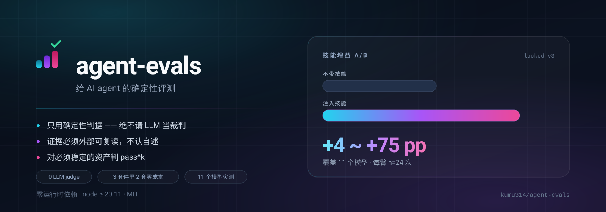
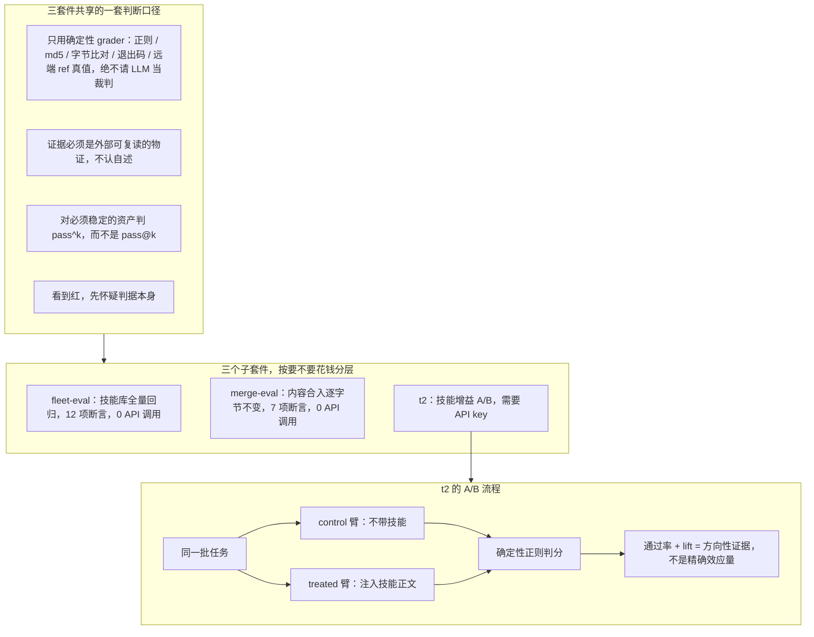

<h1> agent-evals</h1>

中文 | [English](README.md)



[](https://github.com/kumu314/agent-evals/actions/workflows/ci.yml)
[](LICENSE)
[](package.json)
[](package.json)
[](CHANGELOG.md)
[](docs/t2-results.md)

**在线榜单：** <https://kumu314.github.io/agent-evals/>

> **一句话结论** — 在一把锁定的确定性 8 任务 A/B 尺子（`temperature=0`、AND 门判分）上，注入一条写得好的 skill 能抬升模型通过率。**11 个模型**的抬升跨度为 **+4 ~ +75 个百分点**——其中 10 个越过 +38，唯一的能力下限是 glm-4-flash。没有 LLM 裁判、不靠感觉：这里每个数字都是一条可重跑的断言。

**适合谁：** 要给自己的 agent 技能或内容流水线加一道「会响亮且可复现地报红」回归闸的团队——三套件里有两套零 API 成本即可跑。**不适合谁：** 想找一套拿 LLM 当裁判打分的量表的人——本仓库刻意不这么做。

把「AI agent 干活到底靠不靠谱」写成可机械判定的断言，每次改动后跑一遍，掉了就报红。

## 目录

- [快速开始](#快速开始)
- [盒子里有什么](#盒子里有什么)
- [全景图](#全景图)
- [t2 测什么、不测什么](#t2-测什么不测什么)
- [t2 完整证据链](docs/t2-results.zh-CN.md)
- [可复现契约](#可复现契约)
- [跑起来长什么样](#跑起来长什么样)
- [目录结构](#目录结构)
- [怎么参与](#怎么参与)
- [路线图](#路线图)
- [一处诚实说明](#一处诚实说明)
- [谁做的、给谁看](#谁做的给谁看)
- [许可](#许可)

## 快速开始

**无需构建、无需安装**——零运行时依赖，clone 下来直接跑。

需要 Node ≥ 20.11（用了 `import.meta.dirname` 与内置 `fetch`）。运行时门槛已写进 `package.json` 的 `engines`。

```bash
# 0) 一键看效果：拿仓库自带的样例技能库跑，先红后绿（零配置、零 API）
node demo/run.mjs

# 一键跑完全部零 API/零网络自检（等价于 CI，跨平台；env 在进程内设，不用 shell 前缀）
npm test          # = node run-checks.mjs，逐步打印 rc 台账，任一失败即非零退出

# 1) T2 判分管线自检：零 API 调用，证明「判据真的能区分好坏答案」
node t2/smoke-ab.mjs --dry

# 1b) 对刚跑出的运行目录做离线报告：只读 manifest + rows，不联网
node t2/report.mjs out/t2/<run-id> --format markdown

# 1c) 用示例配置固定参数跑 dry（配置只含公开字段，密钥仍只从环境读）
node t2/smoke-ab.mjs --config t2/t2.example.json --dry

# 2) fleet-eval：先指到你的技能库根目录，再跑
FLEET_SHARED=/path/to/sharedskills node fleet-eval/fleet-eval.mjs --trials 2

# 3) merge-eval：先指到被测仓库 + 合入前的 sha
MERGE_REPO=/path/to/repo MERGE_REPO_SLUG=owner/repo \
MERGE_BASE_REF=<合入前的 sha> MERGE_TOUCHED_IDS='["id1","id2"]' \
node merge-eval/merge-eval.mjs --trials 2
```

`--dry` 结束时会打印 `evidence = out/t2/<run-id>`，那串目录名就是上面的 `<run-id>`；`out/` 已被 Git 忽略。各套件的环境变量、判据清单、以及踩过的坑，都在各子目录的 README 里。

## 盒子里有什么

三个子套件，按「要不要花钱」分层：

| 套件 | 测什么 | 成本 | 需要什么 |
|---|---|---|---|
| [`fleet-eval/`](fleet-eval/) | 技能库全量回归：frontmatter 合法性、重名、垃圾残留、多端扇出一致性（12 项断言） | 0 API 调用 | 一个磁盘上的技能库 |
| [`merge-eval/`](merge-eval/) | 批量内容合入：未触及的条目必须逐字节不变（7 项断言） | 0 API 调用 | 一个被测仓库 |
| [`t2/`](t2/) | 技能增益 A/B：同一批任务，带技能 vs 不带技能，比通过率 | 需要 API key | 任意 OpenAI 兼容端点 |

## 全景图



## 为什么这样拆

三套件共享同一套判断口径，也是这个仓库存在的理由：

1. **能确定性判定，就不要请 LLM 当裁判。** 三个套件的 grader 全部是确定性断言——正则、md5、字节比对、退出码、远端 ref 真值。没有一个用模型打分：既贵，又不可复现。
2. **证据必须来自外部可复读的物证。** 判据只认远端 API 读数、文件 sha256、磁盘真实状态，不认「我跑完了」「命令没报错」这类自述。
3. **面向「必须稳定」的资产判 `pass^k`，不判 `pass@k`。** 技能库和内容库的正确性是红线，要求 N 次里每次都过，而不是蒙对一次就算。
4. **判据本身也会出错，看到红先怀疑判据。** merge-eval 第一轮跑出来的红全是它自己的 bug。这条写进了两个子套件的 README，因为它是这里最贵的经验。

这四条不是原创，来源见 [fleet-eval/research/](fleet-eval/research/)（Anthropic《Demystifying evals for AI agents》、NVIDIA 的 agent evaluation 实践）。

## t2 测什么、不测什么

t2 是**模型档位选型工具**，不是「技能通用有效性」工具。它回答的问题是：「把这条 skill 注入某个模型档位，能不能让该档位在该任务上从 FAIL 变 PASS」——这个答案**高度依赖模型能力上限**。

**注入不等于激活。** treated 臂是把技能正文直接放进上下文；真实 harness 只加载技能的元数据，由模型自己决定要不要激活。所以这里的每个数字都是「技能最多能买到多少」的上限，不是你在生产里会看到的激活率。

**被测技能范围。** 这里 t2 被测的七颗技能全是「验证纪律 / 失效取证」体裁——每颗编码一条具体、可判定的操作。另有两种体裁在这把锁定尺子之外：领域知识有一个小体裁试点，负向臂（毒饵）则从反方向检验打分器（均见下文「锁尺之外的两条臂」）。创意、风格完全不在本测范围，所以上面的 lift 表只是这个体裁的证据，不是「技能普遍有用」的断言。

### 每个数字怎么读

下面所有行共用一套口径，集中说一次，不再在每个模型后重复：

- **同一把锁定尺子**——8 任务 × 3 trials × 2 臂 = 每臂 24 次，`temperature=0`，确定性正则判分。判分是 **AND 门**：一次试必须命中该任务的**全部**判据才算 PASS。
- **`lift` = treated - control**，单位百分点。它是**方向性证据，不是精确效应量**——n=24 下单次运行方差主导。
- **思考配置是一列真实信息，不是噪声。** 部分推理模型默认思考会撞破 harness 的 60s 超时，故以降级档跑（`reasoning_effort=low` / `thinking:disabled`）；其裸答下限是该档位的特性，不等于 native-max 能力。降级 / 关闭思考的逐型号原因，记在 [docs/t2-results.zh-CN.md](docs/t2-results.zh-CN.md)。

### 读数总览（锁定的 v2+v3 尺子）

| 供应商 | 模型 | control（裸答下限） | treated | lift | 思考配置 |
|---|---|---|---|---|---|
| DeepSeek | deepseek-chat | 29% (7/24) | 88% (21/24) | **+58 pp** | 原生 |
| DeepSeek | deepseek-reasoner (R1) | 13% (3/24) | 79% (19/24) | **+67 pp** | 原生 |
| DeepSeek | deepseek-flash | 36% (8/22) | 91% (21/23) | **+55 pp** | 原生 |
| 智谱 | glm-4-plus | 8% (2/24) | 67% (16/24) | **+58 pp** | 原生 |
| 智谱 | glm-4-flash | 13% (3/24) | 17% (4/24) | **+4 pp** | 原生 |
| 智谱 | glm-5.3 | 13% (3/24) | 88% (21/24) | **+75 pp** | `reasoning_effort=low` |
| MIMO | mimo-v2.6-flash | 17% (4/24) | 79% (19/24) | **+63 pp** | `thinking:disabled` |
| MIMO | mimo-v2.6-pro | 29% (7/24) | 96% (23/24) | **+67 pp** | `thinking:disabled` |
| 阿里云 | qwen3.8-flash | 29% (7/24) | 75% (18/24) | **+46 pp** | `reasoning_effort=low` |
| 阿里云 | qwen3.8-max | 25% (6/24) | 63% (15/24) | **+38 pp** | `reasoning_effort=low` |
| 阶跃星辰 | step-5-preview | 21% (5/24) | 83% (20/24) | **+63 pp** | 原生 |

各行工具调用均为 0；瞬时上游断连不计入通过率分母（确切有效调用数见结果文档）。**逐模型完整读数、v2/v3 判据校准记录、逐任务拆解，都在 [docs/t2-results.zh-CN.md](docs/t2-results.zh-CN.md)。**

### 这批 fleet 告诉我们什么

- **技能增益真实、而且通常很大。** 十一个被测模型的 lift 落在 **+4 ~ +75 pp**，其中十个都在 +38 及以上。唯一的弱行是 `glm-4-flash`（+4）——注入几乎没推动它，这恰恰是下面几条要你「测到具体模型、别只认档位」的原因。
- **lift 跟着裸答下限走，而非模型档位。** 最宽的差落在*最低*的下限上（R1 13% -> +67、glm-5.3 13% -> +75）；最窄的落在*最高*的下限上（qwen3.8-max 25% -> +38）。`step-5-preview` 是旗舰却下限很低（21%），所以 lift 偏宽（+63）——一个模型的下限是它恰不恰好命中这些具体判据，并不是它强度的干净代理。
- **档位不能跨品牌画等号。** 同一条 skill、同一套判据：`glm-4-flash` lift +4，而 `mimo-v2.6-flash` lift +63——要测到具体模型，别只认档位名。
- **同品牌内，档位差比跨品牌更陡。** 只论智谱，`glm-4-flash`（+4）-> `glm-4-plus`（+58）：一次换档就把效应量从 0 抬到 +58。
- **天花板是局部的、不是全局的。** 通用推理本就能解的任务（`bad-advice-runtime`）双臂饱和、该点贡献 0 lift；AND 门在领域任务上始终留至少一条技能独有判据未命中，所以聚合值从不塌成 0。

### 锁尺之外的两条臂

上面那把锁定的尺子之外另挂两条臂，且刻意不进读数总览表，表的口径从不因它们而移动：

- **负向（毒饵）臂。** 往 treated 臂注入一份刻意写错的技能，要求打分器认出模型被带偏——treated 读数应*低于* control。它作为 fail-closed 自检跑在 `npm test` 里：在预置答案上，打分器给出的读数与正向量尺截然相反，证明正则能双向开火。至于真模型会不会真被带偏，仍是未解问题、不是已证结论（见结果文档）；下一步是在那里换一颗更诱人的毒饵。
- **领域知识体裁试点。** 为检验这套 harness 能否跳出「验证纪律」体裁，一条领域知识任务（`cache-nocache-vs-nostore`，用 `http-cache-semantics` 技能）作为体裁试点跑起来。它被标为默认跑排除、只有显式点名才触发，所以既不进锁定的尺子、也不动上面的表；目前只有自检、尚无实测 lift。

### 使用建议

- 想验证「我的 skill 到底有没有用」-> 先确保测试档位 >= 目标部署档位，否则测的是模型上限而不是 skill 质量。
- 想选「该给 agent 配哪个模型档位」-> 同一条 skill 在不同档位 lift 的差异就是选型信号。
- 不要把「lift = 0」解读为「skill 没用」——它只是说「这个档位读不懂」。

## 可复现契约

一次运行只有别人能重读才有价值。这里把两件事钉死，而不是留成默认：

**退出码**

| 码 | 含义 |
|---|---|
| `0` | COMPLETE —— 每个请求的 cell 都跑完，证据已落盘 |
| `1` | fatal：配置坏了、判据坏了，或证据无法读取/升级 |
| `2` | INCOMPLETE —— 运行确实执行了，但至少一个 cell 以 ERROR / TOOLCALL 收尾 |

`2` 不是 harness 的失败：它表示模型或端点行为异常，证据目录仍然值得归档。`1` 意味着这次运行完全不可信。

**Schema 与证据**

`schema_version = 1` 会写进 `manifest.json`、`summary.json` 和 `report.md`。版本不匹配时，`--resume` 与 `report.mjs` 直接退 `1`，而不是静默迁移。每次运行落在 `out/t2/<run-id>/`，含四个文件：

| 文件 | 内容 |
|---|---|
| `manifest.json` | 公开配置、prompt、技能与判据的 sha256、运行指纹 |
| `rows.jsonl` | 每个 cell 一行，cell 跑完即追加 |
| `summary.json` | 由 rows 重算得出 |
| `report.md` | 人可读的摘要 |

密钥从不写进其中任何一个。用 `--resume` 续跑时，只复用指纹匹配的 cell；其余一律重跑，且 `rows.jsonl` 是只追加的。

一个最小 CI 形状（零 API 成本）：

```yaml
- uses: actions/setup-node@v4
  with: { node-version: '20.11' }
- run: npm test
- run: node --test t2/selftest.mjs
- run: T2_TASK=bad-advice-runtime--poison,race-sleep-poison node t2/smoke-ab.mjs --dry
- run: node fleet-eval/drill-a1a2.mjs
```

## 跑起来长什么样

零配置、不花钱的那条命令（CI 也跑它）：

```bash
node t2/smoke-ab.mjs --dry
```

它用预置答案走一遍判分管线，证明「判据真的能把好答案和坏答案分开」。输出示例（中间任务行省略，`<run-id>` 是本次运行目录）：

```text
evidence = out/t2/<run-id>
provider = DRY (零调用)
tasks    = bad-advice-runtime(runtime-resolution-and-abi), merge-verify-ritual(silent-failure-triage), guard-never-fires(silent-failure-triage), tautology-detector(criterion-self-evidence-check), changed-but-not-visible(stale-output-layers), stale-line-citation(line-anchor-drift), hash-mismatch-invisible(text-encoding-forensics), push-hung-recheck(git-push-fake-timeout)   ruler = locked-v3   trials/arm = 3   arms = control+treated
------------------------------------------------------------------------
[control] bad-advice-runtime base      t1  FAIL      (无命中)  61c
[control] bad-advice-runtime base      t2  FAIL      (无命中)  61c
[control] bad-advice-runtime base      t3  FAIL      (无命中)  61c
[treated] bad-advice-runtime base      t1  PASS      否定便条,钉死手法  185c
[treated] bad-advice-runtime base      t2  PASS      否定便条,钉死手法  185c
[treated] bad-advice-runtime base      t3  PASS      否定便条,钉死手法  185c
...
control 有效 24/24（通过 0）  工具调用 0  报错 0
treated 有效 24/24（通过 24）  工具调用 0  报错 0
control pass = 0% [0,14]   treated pass = 100% [86,100]   lift = 100 个百分点
=> 两臂可区分（管线有判别力）
```

`evidence = ...` 那行就是 `report.mjs` 的入参目录；对同一份 `manifest.json` + `rows.jsonl`，`--format json` 的输出与 `summary.json` 逐字段一致。

（以上为节选；`--dry` 用的是固定的预置答案，所以 control 得 0、treated 得 100——它验的是尺子，不是模型。）

## 目录结构

```
agent-evals/
├── assets/            logo.svg + 首屏主视觉
├── demo/              一键 demo：自带样例技能库，先红后绿（零配置）
├── docs/              eval-primitives.md —— 三套件实证提炼的五条评测原语
├── fleet-eval/        技能库回归（12 项断言，零 API 成本）
│   ├── fleet-eval.mjs
│   ├── drill-a1a2.mjs     反向验证脚本：证明新增断言真的会红
│   ├── fleet-eval.allow.example.json  junk.absent 豁免白名单模板（真的那份不入库）
│   └── research/          方法论来源
├── lib/               parsers.mjs —— 三套件共用的三颗解析器（唯一实现）
├── merge-eval/        批量内容合入回归（7 项断言）
│   ├── merge-eval.mjs
│   ├── drill-merge-eval.mjs  反向验证 drill：TMP git fixture，零网络
│   └── README.md
├── selftest.mjs       lib/parsers.mjs 的单元测试（node:test，零依赖）
└── t2/                技能增益 A/B（需要 API key）
    ├── smoke-ab.mjs
    ├── report.mjs         离线报告，只读 manifest + rows
    ├── selftest.mjs       t2 各模块的单元 + 集成测试
    ├── t2.example.json    公开配置示例（不含密钥）
    ├── lib/               config / grader / stats / store / prompt-variants
    ├── fixtures/          criteria.json —— 正向、负向与毒饵对照
    └── skills/            锁尺七颗验证纪律技能，另有两颗负向臂毒饵与一颗领域知识试点（均自研，MIT）
```

## 怎么参与

一个人维护、每天在用——所以最省事的有价值贡献是提一个说得清的 issue，而不是直接发 PR。完整规矩在 [CONTRIBUTING.md](CONTRIBUTING.md)（[中文](CONTRIBUTING.zh-CN.md)），简版三条：

- **给判据挑错，而不只是给代码挑错。** 一条误伤你的判据、或一个本该红却还绿着的破口，比功能请求值钱得多。这里的文化是「看到红，先怀疑红本身」。
- **任何改判据语义的改动，必须附上能让它真变红的反例。** 只会绿的检查不予合入。
- **动模型（`*.mjs`）的 PR：先开 issue 谈。** 一个人没有评审带宽，没讨论过的 PR 大概率烂在未合里；文档与错别字修正可直接提。

## 路线图

按优先级——下面每条都是*未完成*的方向，不是已上线的功能：

- **把负向臂从自检做成实测结论。** 两颗毒饵（运行时 ABI、并发竞态）现已 fail-closed 跑在 `npm test` 里。目标是让一颗毒饵把某个真模型拖*到它自己 control 底线之下*——证明这套尺子能认出「模型被带偏」，而不只是认出预置的错误答案。
- **越出单一体裁。** 七颗锁尺技能全是「验证纪律 / 失效取证」。`cache-nocache-vs-nostore`（领域知识）是第一个体裁试点；再加体裁，lift 表才可能从「本体裁的证据」往「可迁移」推一步。
- **收窄统计。** 榜首各行是 n=24 的单次跑，Wilson 区间因而偏宽。重复跑能把方向性 lift 变成效应量——它要花 API 钱，所以保持按需手动触发。
- **守住天花板的诚实。** 模型档位会下架、会重发；结果文档逐行钉住思考配置与抓取日期，让每个数字能被重新验证，或被显式标注为过期。
- **抓到已经扇到端点上的垃圾。** `junk.absent` 只扫源树、`endpoints.skillmd-parity` 只比 `SKILL.md`；两者都看不见「在排除规则出现之前就扇出去、现已滞留在某个端点上的垃圾」。补一遍端点侧扫描——同一套 `excludeDirs`、逐个端点跑——正好补上作者自己技能库刚暴露出的这个盲区。

## 一处诚实说明

`fleet-eval` 和 `merge-eval` 来自作者自己的两个真实项目：一个共享技能库（240+ 技能、4 个扇出端点）和一个内容站的批量灌库流水线。它们的判据与坑清单都来自真实事故，所以文档里保留了很多「在这台机器上实测」的具体读数——那些不是设计目标，是现场证据。

## 谁做的、给谁看

由我（[@kumu314](https://github.com/kumu314)）为自己的日常使用而写，顺手开源。

适合手里握着「坏了很烦、但又不愿每轮回归都再付一次模型调用费」这类资产的人——技能库、内容库、多端分发配置。不适合把评测当榜单刷的人。

## 许可

MIT，见 [LICENSE](LICENSE)。
