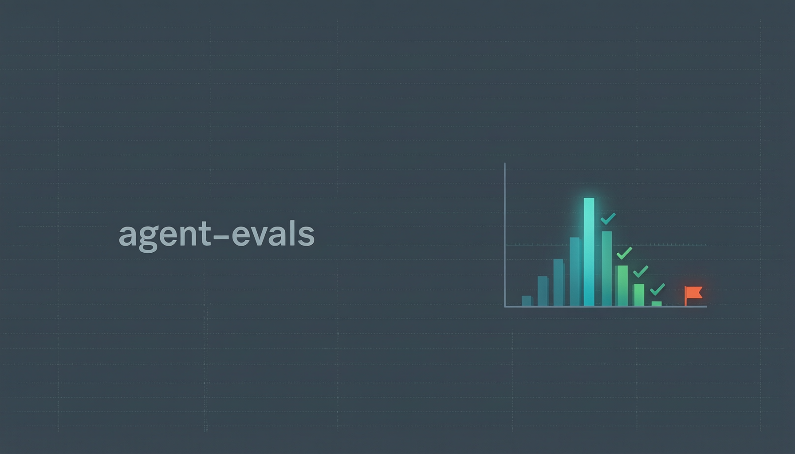
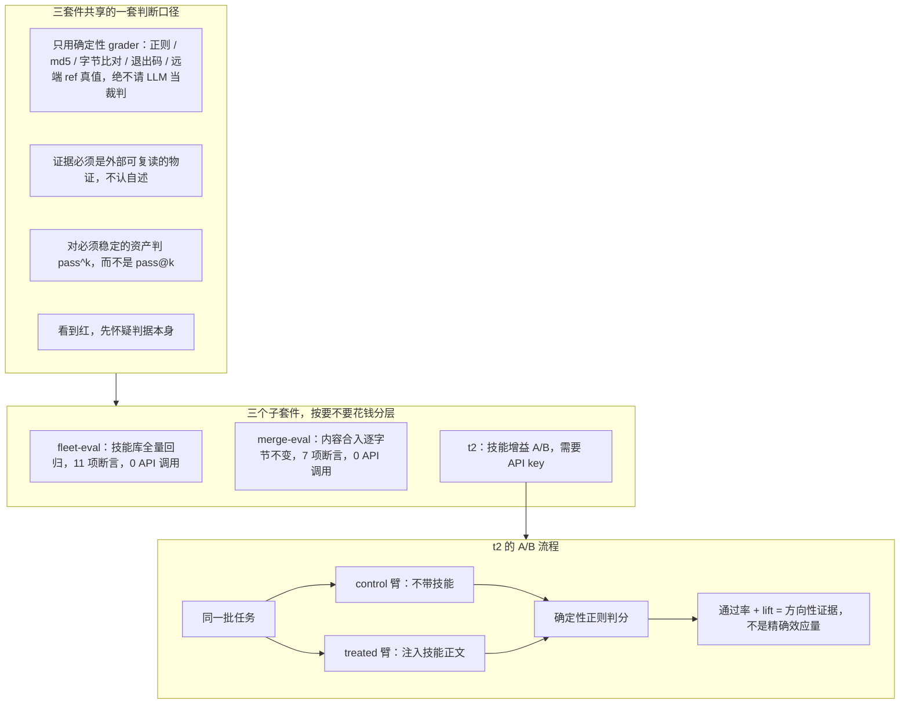

# agent-evals

中文 | [English](README.md)



[](https://github.com/kumu314/agent-evals/actions/workflows/ci.yml)
[](LICENSE)
[](package.json)
[](package.json)
[](CHANGELOG.md)
[](docs/t2-results.md)

> **一句话结论** — 在一把锁定的确定性 8 任务 A/B 尺子（`temperature=0`、AND 门判分）上，注入一条写得好的 skill 能抬升模型通过率。**11 个模型**的抬升跨度为 **+4 ~ +75 个百分点**——其中 10 个越过 +38，唯一的能力下限是 glm-4-flash。没有 LLM 裁判、不靠感觉：这里每个数字都是一条可重跑的断言。

**适合谁：** 要给自己的 agent 技能或内容流水线加一道"会响亮且可复现地报红"回归闸的团队——三套件里有两套零 API 成本即可跑。**不适合谁：** 想找一套拿 LLM 当裁判打分的量表的人——本仓库刻意不这么做。

把「AI agent 干活到底靠不靠谱」写成可机械判定的断言，每次改动后跑一遍，掉了就报红。

三个子套件，按"要不要花钱"分层：

| 套件 | 测什么 | 成本 | 需要什么 |
|---|---|---|---|
| [`fleet-eval/`](fleet-eval/) | 技能库全量回归：frontmatter 合法性、重名、垃圾残留、多端扇出一致性（11 项断言） | 0 API 调用 | 一个磁盘上的技能库 |
| [`merge-eval/`](merge-eval/) | 批量内容合入：未触及的条目必须逐字节不变（7 项断言） | 0 API 调用 | 一个被测仓库 |
| [`t2/`](t2/) | 技能增益 A/B：同一批任务，带技能 vs 不带技能，比通过率 | 需要 API key | 任意 OpenAI 兼容端点 |

## 目录

- [全景图](#全景图)
- [为什么这样拆](#为什么这样拆)
- [t2 测什么、不测什么](#t2-测什么不测什么)
- [t2 完整证据链](docs/t2-results.zh-CN.md)
- [快速开始](#快速开始)
- [跑起来长什么样](#跑起来长什么样)
- [目录结构](#目录结构)
- [一处诚实说明](#一处诚实说明)
- [谁做的、给谁看](#谁做的给谁看)
- [许可](#许可)

## 全景图



## 为什么这样拆

三套件共享同一套判断口径，也是这个仓库存在的理由：

1. **能确定性判定，就不要请 LLM 当裁判。** 三个套件的 grader 全部是确定性断言——正则、md5、字节比对、退出码、远端 ref 真值。没有一个用模型打分：既贵，又不可复现。
2. **证据必须来自外部可复读的物证。** 判据只认远端 API 读数、文件 sha256、磁盘真实状态，不认"我跑完了""命令没报错"这类自述。
3. **面向"必须稳定"的资产判 `pass^k`，不判 `pass@k`。** 技能库和内容库的正确性是红线，要求 N 次里每次都过，而不是蒙对一次就算。
4. **判据本身也会出错，看到红先怀疑判据。** merge-eval 第一轮跑出来的红全是它自己的 bug。这条写进了两个子套件的 README，因为它是这里最贵的经验。

这三条不是原创，来源见 [fleet-eval/research/](fleet-eval/research/)（Anthropic《Demystifying evals for AI agents》、NVIDIA 的 agent evaluation 实践）。

## t2 测什么、不测什么

t2 是**模型档位选型工具**，不是"技能通用有效性"工具。它回答的问题是："把这条 skill 注入某个模型档位，能不能让该档位在该任务上从 FAIL 变 PASS"——这个答案**高度依赖模型能力上限**。

**注入不等于激活。** treated 臂是把技能正文直接放进上下文；真实 harness 只加载技能的元数据，由模型自己决定要不要激活。所以这里的每个数字都是"技能最多能买到多少"的上限，不是你在生产里会看到的激活率。

### 每个数字怎么读

下面所有行共用一套口径，集中说一次，不再在每个模型后重复：

- **同一把锁定尺子**——8 任务 × 3 trials × 2 臂 = 每臂 24 次，`temperature=0`，确定性正则判分。判分是 **AND 门**：一次试必须命中该任务的**全部**判据才算 PASS。
- **`lift` = treated - control**，单位百分点。它是**方向性证据，不是精确效应量**——n=24 下单次运行方差主导。
- **思考配置是一列真实信息，不是噪声。** 部分推理模型默认思考会撞破 harness 的 60s 超时，故以降级档跑（`reasoning_effort=low` / `thinking:disabled`）；其裸答下限是该档位的特性，不等于 native-max 能力。

### 读数总览（锁定的 v2+v3 尺子）

| 供应商 | 模型 | control（裸答下限） | treated | lift | 思考配置 |
|---|---|---|---|---|---|
| DeepSeek | deepseek-chat | 29% (7/24) | 88% (21/24) | **+58 pp** | 原生 |
| DeepSeek | deepseek-reasoner (R1) | 13% (3/24) | 79% (19/24) | **+67 pp** | 原生 |
| DeepSeek | deepseek-flash | 36% (8/22) | 91% (21/23) | **+55 pp** | 原生 |
| 智谱 | glm-4-plus | 8% (2/24) | 67% (16/24) | **+58 pp** | 原生 |
| 智谱 | glm-4-flash | 13% (3/24) | 17% (4/24) | **+4 pp** | 原生 |
| 智谱 | glm-5.3 | 13% (3/24) | 88% (21/24) | **+75 pp** | `reasoning_effort=low` |
| MIMO | mimo-v2.6-flash | 17% (4/24) | 79% (19/24) | **+63 pp** | `thinking:disabled` |
| MIMO | mimo-v2.6-pro | 29% (7/24) | 96% (23/24) | **+67 pp** | `thinking:disabled` |
| 阿里云 | qwen3.8-flash | 29% (7/24) | 75% (18/24) | **+46 pp** | `reasoning_effort=low` |
| 阿里云 | qwen3.8-max | 25% (6/24) | 63% (15/24) | **+38 pp** | `reasoning_effort=low` |
| 阶跃星辰 | step-5-preview | 21% (5/24) | 83% (20/24) | **+63 pp** | 原生 |

各行工具调用均为 0；瞬时上游断连不计入通过率分母（确切有效调用数见结果文档）。**逐模型完整读数、v2/v3 判据校准记录、逐任务拆解，都在 [docs/t2-results.zh-CN.md](docs/t2-results.zh-CN.md)。**

### 这批 fleet 告诉我们什么

- **技能增益真实、且一直很大。** 凡能读懂它的模型，lift 都在 **+38 ~ +75 pp**——没有哪个模型（旗舰也不例外）把它压向 0。
- **lift 跟着裸答下限走，而非模型档位。** 最宽的差落在*最低*的下限上（R1 13% -> +67、glm-5.3 13% -> +75）；最窄的落在*最高*的下限上（qwen3.8-max 25% -> +38）。`step-5-preview` 是旗舰却下限很低（21%），所以 lift 偏宽（+63）——一个模型的下限是它恰不恰好命中这些具体判据，并不是它强度的干净代理。
- **档位不能跨品牌画等号。** 同一条 skill、同一套判据：`glm-4-flash` lift +4，而 `mimo-v2.6-flash` lift +63——要测到具体模型，别只认档位名。
- **同品牌内，档位差比跨品牌更陡。** 只论智谱，`glm-4-flash`（+4）-> `glm-4-plus`（+58）：一次换档就把效应量从 0 抬到 +58。
- **天花板是局部的、不是全局的。** 通用推理本就能解的任务（`bad-advice-runtime`）双臂饱和、该点贡献 0 lift；AND 门在领域任务上始终留至少一条技能独有判据未命中，所以聚合值从不塌成 0。

### 使用建议

- 想验证"我的 skill 到底有没有用"-> 先确保测试档位 >= 目标部署档位，否则测的是模型上限而不是 skill 质量。
- 想选"该给 agent 配哪个模型档位"-> 同一条 skill 在不同档位 lift 的差异就是选型信号。
- 不要把"lift = 0"解读为"skill 没用"——它只是说"这个档位读不懂"。

## 快速开始

需要 Node ≥ 20.11（用了 `import.meta.dirname` 与内置 `fetch`）。运行时门槛已写进 `package.json` 的 `engines`。

```bash
# 一键跑完全部零 API/零网络自检（等价于 CI，跨平台；env 在进程内设，不用 shell 前缀）
npm test          # = node run-checks.mjs，逐步打印 rc 台账，任一失败即非零退出

# 0) 一键看效果：拿仓库自带的样例技能库跑，先红后绿（零配置、零 API）
node demo/run.mjs

# 1) T2 判分管线自检：零 API 调用，证明"判据真的能区分好坏答案"
node t2/smoke-ab.mjs --dry

# 2) fleet-eval：先指到你的技能库根目录，再跑
FLEET_SHARED=/path/to/sharedskills node fleet-eval/fleet-eval.mjs --trials 2

# 3) merge-eval：先指到被测仓库 + 合入前的 sha
MERGE_REPO=/path/to/repo MERGE_REPO_SLUG=owner/repo \
MERGE_BASE_REF=<合入前的 sha> MERGE_TOUCHED_IDS='["id1","id2"]' \
node merge-eval/merge-eval.mjs --trials 2
```

各套件的环境变量、判据清单、以及踩过的坑，都在各子目录的 README 里。

## 跑起来长什么样

零配置、不花钱的那条命令（CI 也跑它）：

```bash
node t2/smoke-ab.mjs --dry
```

它用预置答案走一遍判分管线，证明「判据真的能把好答案和坏答案分开」。完整输出：

```text
provider = DRY (零调用)
tasks    = bad-advice-runtime(runtime-resolution-and-abi), merge-verify-ritual(silent-failure-triage), guard-never-fires(silent-failure-triage), tautology-detector(criterion-self-evidence-check), changed-but-not-visible(stale-output-layers), stale-line-citation(line-anchor-drift), hash-mismatch-invisible(text-encoding-forensics), push-hung-recheck(git-push-fake-timeout)   trials/arm = 3   arms = control+treated
------------------------------------------------------------------------
[control] bad-advice-runtime t1  FAIL      (无命中)  61c
[control] bad-advice-runtime t2  FAIL      (无命中)  61c
[control] bad-advice-runtime t3  FAIL      (无命中)  61c
[treated] bad-advice-runtime t1  PASS      否定便条,钉死手法  185c
[treated] bad-advice-runtime t2  PASS      否定便条,钉死手法  185c
[treated] bad-advice-runtime t3  PASS      否定便条,钉死手法  185c
[control] merge-verify-ritual t1  FAIL      (无命中)  70c
[control] merge-verify-ritual t2  FAIL      (无命中)  70c
[control] merge-verify-ritual t3  FAIL      (无命中)  70c
[treated] merge-verify-ritual t1  PASS      退出码0无信息,REST口径陷阱,正确复核  229c
[treated] merge-verify-ritual t2  PASS      退出码0无信息,REST口径陷阱,正确复核  229c
[treated] merge-verify-ritual t3  PASS      退出码0无信息,REST口径陷阱,正确复核  229c
[control] guard-never-fires  t1  FAIL      (无命中)  92c
[control] guard-never-fires  t2  FAIL      (无命中)  92c
[control] guard-never-fires  t3  FAIL      (无命中)  92c
[treated] guard-never-fires  t1  PASS      列序根因,恒假死代码  175c
[treated] guard-never-fires  t2  PASS      列序根因,恒假死代码  175c
[treated] guard-never-fires  t3  PASS      列序根因,恒假死代码  175c
[control] tautology-detector t1  FAIL      (无命中)  38c
[control] tautology-detector t2  FAIL      (无命中)  38c
[control] tautology-detector t3  FAIL      (无命中)  38c
[treated] tautology-detector t1  PASS      硬编码脆弱,换统计量  90c
[treated] tautology-detector t2  PASS      硬编码脆弱,换统计量  90c
[treated] tautology-detector t3  PASS      硬编码脆弱,换统计量  90c
[control] changed-but-not-visible t1  FAIL      (无命中)  70c
[control] changed-but-not-visible t2  FAIL      (无命中)  70c
[control] changed-but-not-visible t3  FAIL      (无命中)  70c
[treated] changed-but-not-visible t1  PASS      身份非缓存,分层定位,取证读数  229c
[treated] changed-but-not-visible t2  PASS      身份非缓存,分层定位,取证读数  229c
[treated] changed-but-not-visible t3  PASS      身份非缓存,分层定位,取证读数  229c
[control] stale-line-citation t1  FAIL      (无命中)  54c
[control] stale-line-citation t2  FAIL      (无命中)  54c
[control] stale-line-citation t3  FAIL      (无命中)  54c
[treated] stale-line-citation t1  PASS      行号不稳定,改数字治标,换内容锚  192c
[treated] stale-line-citation t2  PASS      行号不稳定,改数字治标,换内容锚  192c
[treated] stale-line-citation t3  PASS      行号不稳定,改数字治标,换内容锚  192c
[control] hash-mismatch-invisible t1  FAIL      (无命中)  57c
[control] hash-mismatch-invisible t2  FAIL      (无命中)  57c
[control] hash-mismatch-invisible t3  FAIL      (无命中)  57c
[treated] hash-mismatch-invisible t1  PASS      不可见字节,hexdump取证,diff会漏  238c
[treated] hash-mismatch-invisible t2  PASS      不可见字节,hexdump取证,diff会漏  238c
[treated] hash-mismatch-invisible t3  PASS      不可见字节,hexdump取证,diff会漏  238c
[control] push-hung-recheck  t1  FAIL      (无命中)  73c
[control] push-hung-recheck  t2  FAIL      (无命中)  73c
[control] push-hung-recheck  t3  FAIL      (无命中)  73c
[treated] push-hung-recheck t1  PASS      中断不等于失败,认远端读数,不信自述  263c
[treated] push-hung-recheck t2  PASS      中断不等于失败,认远端读数,不信自述  263c
[treated] push-hung-recheck t3  PASS      中断不等于失败,认远端读数,不信自述  263c
------------------------------------------------------------------------
control 有效 24/24（通过 0）  工具调用 0  报错 0
treated 有效 24/24（通过 24）  工具调用 0  报错 0
control pass = 0% [0,14]   treated pass = 100% [86,100]   lift = 100 个百分点
=> 两臂可区分（管线有判别力）
```

## 目录结构

```
agent-evals/
├── demo/              一键 demo：自带样例技能库，先红后绿（零配置）
├── docs/              eval-primitives.md —— 三套件实证提炼的五条评测原语
├── fleet-eval/        技能库回归（11 项断言，零 API 成本）
│   ├── fleet-eval.mjs
│   ├── drill-a1a2.mjs     反向验证脚本：证明新增断言真的会红
│   ├── fleet-eval.allow.example.json  junk.absent 豁免白名单模板（真的那份不入库）
│   └── research/          方法论来源
├── lib/               parsers.mjs —— 三套件共用的三颗解析器（唯一实现）
├── merge-eval/        批量内容合入回归（7 项断言）
│   ├── merge-eval.mjs
│   ├── drill-merge-eval.mjs  反向验证 drill：TMP git fixture，零网络
│   └── README.md
├── selftest.mjs       lib/parsers.mjs 的单元测试（node:test，零依赖）
└── t2/                技能增益 A/B（需要 API key）
    ├── smoke-ab.mjs
    └── skills/        七颗被测技能（自研，MIT）
```

## 一处诚实说明

`fleet-eval` 与 `merge-eval` 是从作者自己的两个真实项目里长出来的：一个共享技能库（240+ 颗技能、4 个扇出端点），一个内容站点的批量入库流程。它们的判据和踩坑记录都来自真实事故，所以文档里保留了大量"本机实测"的具体读数——这些不是设计目标，是现场证据。

## 谁做的、给谁看

我（[@kumu314](https://github.com/kumu314)）给自己搭的，顺手开源出来。

适合手里有「坏了就麻烦、又不想每次回归都再花一笔模型调用费」的资产的人——技能库、内容库、多端分发的配置。不适合把 evals 当榜单刷的人。

## 许可

MIT，见 [LICENSE](LICENSE)。
